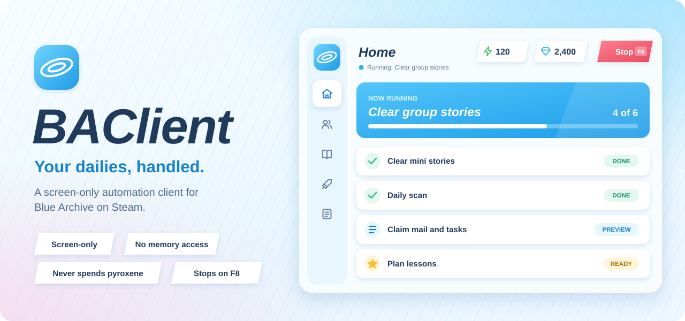
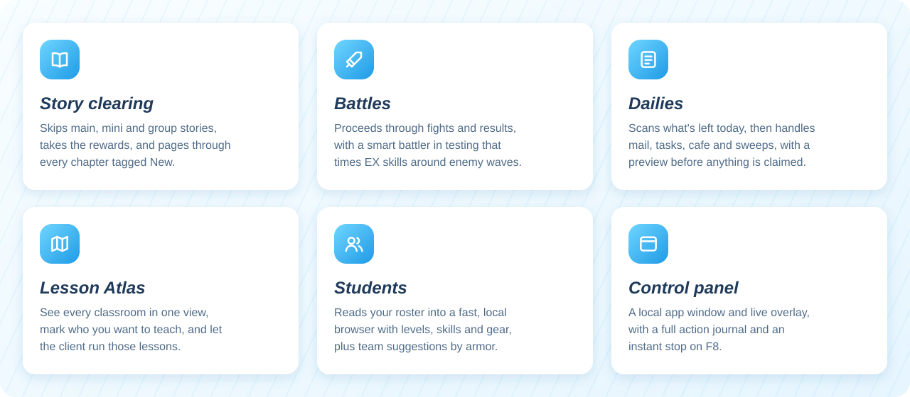
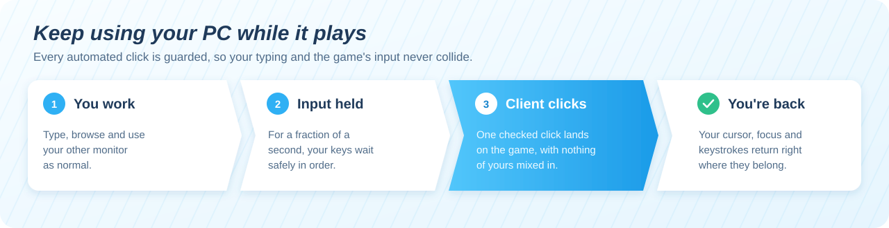

<p align="center">
  
</p>

<p align="center">
  <b>Windows</b> &nbsp;·&nbsp; <b>Python 3.13</b> &nbsp;·&nbsp; <b>OpenCV + Windows OCR</b> &nbsp;·&nbsp; <b>Local only</b>
</p>

BAClient watches the Blue Archive window, recognizes what's on screen, and plays with ordinary mouse clicks. It doesn't read game memory, inject code or patch the game, and nothing leaves your PC.

> [!WARNING]
> **Use at your own risk.** Nexon's terms forbid third-party automation, so using this tool can put your account at risk. BAClient is an unofficial fan project and is not affiliated with or endorsed by Nexon, Yostar or NAT Games.

<p align="center">
  
</p>

<p align="center">
  
</p>

## Built to be careful

| | |
|---|---|
| **Never spends premium currency** | Recruit, AP refills and paid shop items are blocked. The one Cash Shop exception is a narrowly checked claim of the item priced "Free" |
| **Stops when unsure** | Unknown popups, login conflicts and unexpected resource changes halt input until you review them |
| **Previews first** | Claims, cafe runs and lesson plans default to a dry run |
| **Always interruptible** | Press **F8** to stop the current run |
| **Fully logged** | Every automated input is journaled locally with the frame it acted on |

## Status

BAClient is in active development. Some features are proven on the live game, and others have only passed offline tests.

| Feature | Status |
|---|---|
| Story skip, Mini Story clearing, navigation | ✅ Works live |
| Battle auto-proceed, roster scan, daily scan, mission scan | 🟡 Partly proven |
| Group Story clearing, input guard, control panel | 🟡 In live testing |
| Lessons and Lesson Atlas, claims, cafe | 🧪 Built, still being tested |
| Smart battler, Conquest helper, MomoTalk, event stories | 🧪 Built, not proven live |
| Raid runner, Linux support | 🗺️ Planned |

## Getting started

**You need:** Windows, the Steam version of Blue Archive in English, [Python 3.13](https://www.python.org/), and Google Chrome for the control panel.

```powershell
git clone <this-repo-url> BAClient
cd BAClient
py -3.13 -m pip install -r requirements.txt
$env:BA_ACTOR = 'player'
py -3.13 -m ba_auto ctl start
```

### Add your template pack

BAClient recognizes screens using small reference images. **Those images come from the game, so they aren't included in this repository.** The template index lists each expected name and screen position, and you capture the images from your own copy of the game:

```powershell
py -3.13 -m ba_auto shot lobby.png
py -3.13 -m ba_auto cut lobby.png lobby_campaign 1690 950 1890 1060
```

Run the game at 1920x1080 while capturing. A feature stays unavailable until its templates exist.

## Commands

```powershell
py -3.13 -m ba_auto ctl tasks                 # list everything it can do
py -3.13 -m ba_auto ctl run ministories --wait
py -3.13 -m ba_auto ctl run groupstories --limit 1 --wait
py -3.13 -m ba_auto ctl run claims --wait      # preview only
py -3.13 -m ba_auto ctl status
py -3.13 -m ba_auto ctl stop
```

## How it works

```text
 Capture the window  →  Match screens and read text  →  Check safety rules  →  One guarded click  →  Log it
```

| Part | Role |
|---|---|
| `ba_auto/game.py` | Window capture and the single path for all game input |
| `ba_auto/inputguard.py` | Keeps automated clicks and your own input from colliding |
| `ba_auto/vision.py`, `ocr.py` | Template matching and Windows OCR |
| `ba_auto/watchdog.py` | Halts on blockers and unexpected resource changes |
| `ba_auto/tasks/` | Stories, battles, lessons, cafe, claims and more |
| `ba_auto/ui/` | The local control panel, overlay and tray icon |

---

<p align="center"><sub>Blue Archive and all related names and assets belong to their respective owners. This repository contains no game assets.</sub></p>
